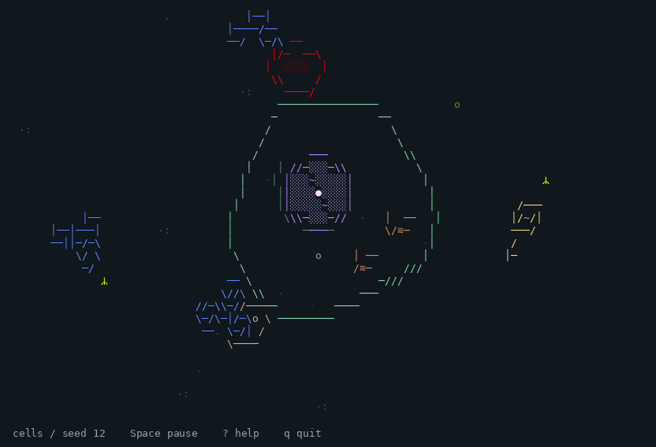

# cells

A living microscope slide in your terminal. Macrophages and neutrophils crawl
through a slow current and digest captured microbes inside little vesicles.
Bacterial chains, corkscrews, colonies, budding yeast, and wriggling trypanosomes
share the slide with branching fungal filaments, red blood cells, and phages.



Inspired by the quiet procedural animation of
[cbonsai](https://github.com/jallbrit/cbonsai) and the little encounters of
[asciiquarium](https://github.com/cmatsuoka/asciiquarium).

## Install and run

Python 3.10+ on Linux or macOS, with the standard-library `curses` module. No
third-party runtime dependencies. Some Linux distributions package curses
separately. Native Windows is not currently supported; use WSL.

```sh
./cells
./cells --seed 42 --theme amber
./cells --density 1.5 --speed 0.7 --ascii
./cells --screensaver
```

Or run `python3 cells.py`. To install this checkout as an isolated terminal app:

```sh
pipx install .
cells
```

The distribution is named **terminal-cells**; its executable is **cells**.
Install a published release with `pipx install terminal-cells`.
You can also use `python3 -m pip install .` inside an active virtual
environment. See [the release guide](docs/RELEASING.md) for publishing and
Ubuntu publishing.

Ubuntu 24.04/26.04 `.deb` downloads, PPA installation, and build instructions are
in [the Ubuntu guide](docs/UBUNTU.md).

Use a terminal at least **80×24**; **120×40 or larger** gives the detailed
organisms room to move. Macrophages are roughly 31–35 columns wide and 16–18
rows tall in a roomy terminal, with a smaller fit for compact windows. Bacteria
have multi-character bodies and swimming flagella; red blood cells are larger
discs with pale centers. Neutrophils retain their smaller size. Compact phages
use one vertical glyph (`ᛘ` / `ᛦ`) or two sideways characters (`>-` / `-<`),
with `Y` as the vertical ASCII fallback. Populations are sparser to leave space for these details.
Below 32×12 the simulation pauses until the window grows.
Unicode and terminal colors are detected automatically. Use `--ascii` for plain
ASCII, `--theme mono` for grayscale, or `NO_COLOR=1` to disable colors entirely.

## Explore

The default mixed slide includes immune cells, red blood cells, nine microbial
forms, phages, and fungi. Engulfment, mitosis, budding, viral replication, nutrient
seeking, and edge arrivals keep it moving. See [biology and illustrated life
cycles](docs/BIOLOGY.md) for the species guide and scientific simplifications.

```sh
cells --scene blood --observe
cells --scene microbial --stats
cells --calm --theme light
cells --color never --unicode never
```

`blood` favors blood-associated shapes and excludes fungal networks; `microbial`
excludes human immune cells and red blood cells. Neither is a realistic sample.
New slides randomize their starting proportions. Offspring retain their type;
periodic arrivals favor missing types and respect population limits.

## Rare sightings and colors

Occasionally a coral rotifer visits and feeds, a neutrophil releases a pale-lilac
DNA trap, or a gray micropipette deposits nutrients. Sightings have staged
animations, population limits, and long cooldowns. Opportunities occur after
3–6 minutes of unpaused wall time; scene conditions determine eligibility.
`--observe` names them, `--no-events` disables them, and `--calm` excludes the
micropipette. See [rare sightings](docs/RARE_EVENTS.md) for details and previews.

The nine microbial body colors are distinct in 256-color themes. Red identifies
red blood cells; lime identifies phages; subdued green identifies food. `?` opens
a scrollable legend in the current palette. See the [full color guide and audit
sheet](docs/COLORS.md), including the limitations of basic-color terminals.

## Interactive microscope

```sh
cells --interactive
```

Use **1 Inspect**, **2 Lyse**, **3 Feed**, or **4 Stir**, then left-click to apply.
The only persistent footer is `? help`. Arrows or hjkl move a reticle;
Tab selects an entity and Enter applies the tool, including on terminals without
mouse support. Tools apply immediately while the scene keeps moving. Lysis
scatters entity-specific debris; nutrients attract microbes; stirring displaces
nearby particles and sustains a brief local current.
Space pauses animations. See [the interaction guide](docs/INTERACTION.md) for
controls, illustrated effects, and how sealed cargo is kept contained.

## Controls

| Key | Action |
| --- | --- |
| `q` / `Esc` | Quit |
| `Space` | Pause / resume |
| `+` / `-` | Adjust simulation speed |
| `r` | New slide (advance the seed) |
| `s` | Toggle observations, population counts, and mitotic stages |
| `?` | Toggle help; simulation pauses while help is open |
| `j` / `k`, arrows | Scroll help in short windows |
| `Ctrl-L` | Redraw |

Screensaver mode exits on any key. Resizing does not exit it.

## Options

| Option | Default | Purpose |
| --- | --- | --- |
| `--seed INTEGER` | Random | Repeat a slide at the same terminal size |
| `--density 0.25..3` | `1` | Scale populations to terminal area |
| `--speed 0.125..8` | `1` | Simulation speed |
| `--fps 1..60` | `30` | Maximum rendering rate |
| `--theme slide\|amber\|light\|mono` | `slide` | Color palette |
| `--scene mixed\|blood\|microbial` | `mixed` | Community preset |
| `--calm` | Off | 0.5× speed, 10 FPS, and no micropipette; explicit speed/FPS override |
| `--no-events` | Off | Disable rare sightings |
| `--color auto\|always\|never` | `auto` | Color policy; auto respects nonempty `NO_COLOR` |
| `--unicode auto\|always\|never` | `auto` | Glyph policy; auto checks UTF encoding |
| `--stats` | Off | Show population and lifecycle statistics |
| `--observe` | Off | Caption events and lifecycle stages |
| `--diagnostics` | Off | Print JSON terminal capability report and exit |
| `--ascii` | Off | ASCII glyphs only |
| `--screensaver` | Off | Any key quits |
| `--interactive` | Off | Inspect, Lyse, Feed, and Stir with mouse or keyboard |
| `--duration SECONDS` | Unlimited | Exit after a wall-clock duration |
| `--snapshot` | Off | Print a plain ASCII frame without needing a terminal |
| `--size COLSxROWS` | `80x24` | Snapshot dimensions |
| `--at SECONDS` | `12` | Snapshot simulation time, from 0 through 3600 |

```sh
./cells --snapshot --seed 42 --size 100x30 --at 12
```

Snapshots always use ASCII without ANSI escape sequences. `--at` is simulation
time, independent of `--speed`. A seed reproduces simulation steps within the same version at a given
size; resizing and interactive actions change the subsequent history.

## Development

```sh
python3 -m pip install -r requirements-dev.txt
ruff check .
ruff format --check .
python3 -m unittest discover -s tests -v
python3 tools/preview.py  # Regenerate the slide and life-cycle SVG previews
```

See [CONTRIBUTING.md](CONTRIBUTING.md) for development setup and contribution
guidelines, [CHANGELOG.md](CHANGELOG.md) for release notes, and
[docs/RELEASING.md](docs/RELEASING.md) for building and verifying distributions.
Ubuntu/macOS CI is configured for Python 3.10 through 3.14, including real
pseudo-terminal tests. Hosted CI results will be available once this repository
is published. The [Zero-Clause BSD license](LICENSE) (SPDX: `0BSD`) permits use, modification,
and redistribution for any purpose without an attribution requirement.

`terminal_cells/` separates simulation models, world updates, rendering, and
terminal/CLI controls. `cells.py` remains a compatibility entry point. Simulation runs at a fixed 30 Hz, independent of
the display rate. The renderer compensates for terminal character proportions
and updates changed character runs. Population caps and gentle replenishment
keep the slide alive indefinitely. Terminal modes are restored on normal exit,
Ctrl-C, and SIGTERM.

Tests cover visible capture and digestion, exclusive targeting, reproducibility,
connected moving nuclei, species colors, animated cell division, bounded
long-running populations, organelles, animated flagella, membrane collisions,
local cup highlighting, shape-following wrapping, organelle fusion, fission and
inheritance, surface-oriented phage attachment, tail contraction, empty capsid
cleanup, contact-based infection, viral replication and lysis,
staged ingestion, resizing, CLI validation, and real pseudo-terminal sessions
for input and cleanup. Generated tests explore sequences of simulation steps and terminal resizes.
See [terminal compatibility](docs/TERMINALS.md) for capability controls and
[the manual page](docs/cells.1) for a compact command reference.
