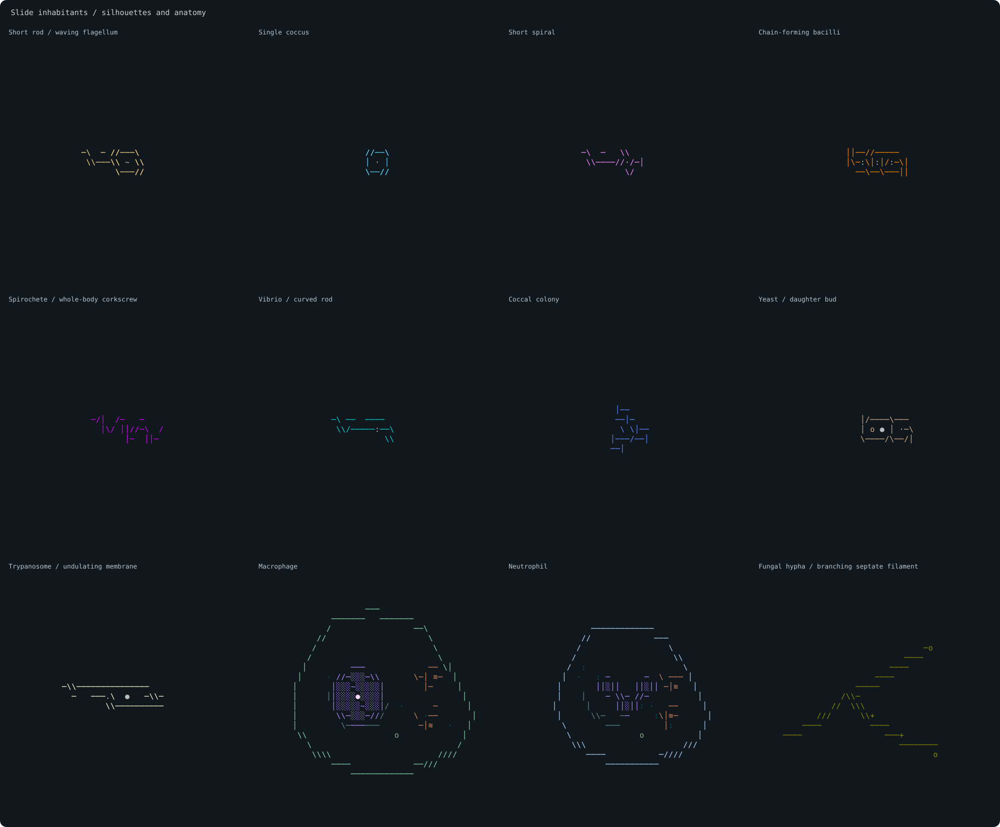
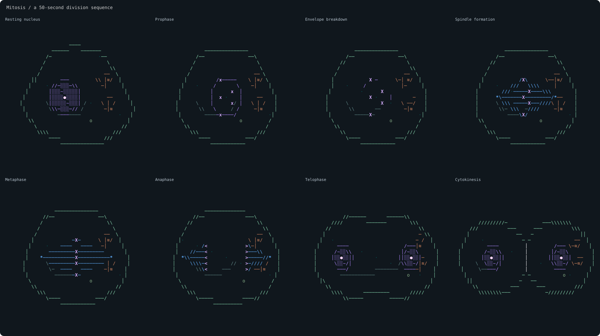
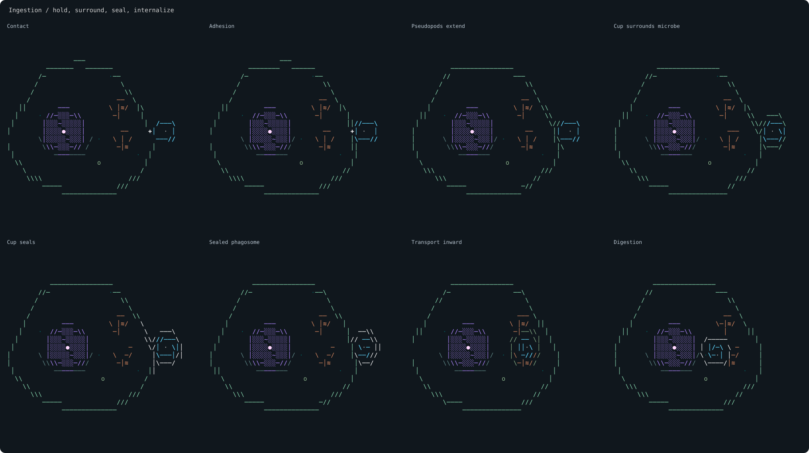
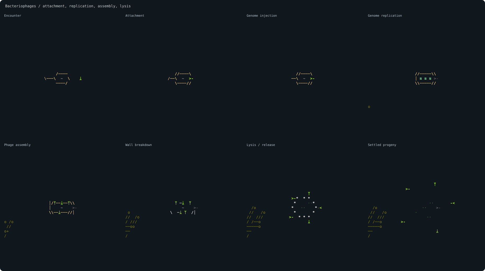
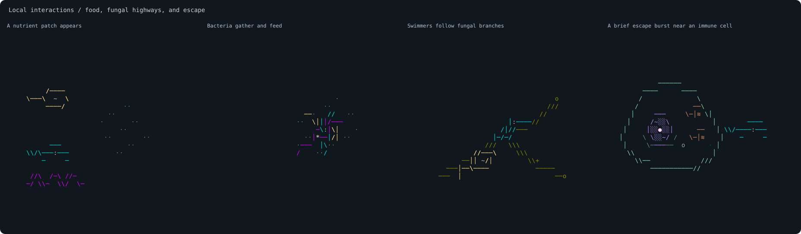

# Biology and animation

## Watch

- **Mint membranes, violet nuclei:** large macrophages with persistent lobes,
  broad leading edges, trailing tips, and small local ruffles. They wander,
  pursue, form a two-armed cup, enclose a bacterium, and rest while digesting it. Each
  nucleus has an envelope, chromatin, and a bright nucleolus, and stays connected
  as the cell moves.
- **Orange branches, teal folds, green puncta:** connected mitochondrial tubules,
  endoplasmic reticulum, and lysosomes. Mitochondria occasionally fuse and split;
  ER folds share connecting branches. These structures persist as the cell moves
  and partition between daughter cells during division.
- **Gold rods, sky-blue cocci, pink spirals:** distinct bacterial types that
  swim, tumble, and divide, with visible cell walls and nucleoids. Rods and
  spirals have waving flagella. Captured microbes keep their color inside vesicles;
  their flagella tuck in as the membrane surrounds them.
- **Orange segmented chains:** chain-forming bacilli. Division extends the chain
  before it separates into shorter chains.
- **Vivid purple corkscrews:** long spirochetes with a traveling whole-body wave,
  rather than an external swimming tail.
- **Turquoise commas:** curved vibrios with waving flagella and faster swimming runs.
- **Royal-blue clusters:** coccal colonies that add beads and split into smaller groups.
- **Tan ovals:** yeast with a vacuole and nucleus. A daughter bud grows over
  twelve seconds before separating.
- **Ivory tapered swimmers:** trypanosomes with an undulating membrane, flagellum,
  and nucleus. Longitudinal fission takes ten seconds.
- **Olive branching filaments:** fungal hyphae. Tips extend and branch, with
  compartment boundaries along the filament; mature networks can seed new growth.
- **Pale blue immune cells:** neutrophils with granules and a connected, lobed
  nucleus. They pursue and engulf microbes, but do not divide.
- **Bright red discs with dark red centers:** drifting red blood cells.
- **Tiny lime fork-shaped particles:** bacteriophages waiting for a bacterial host.
  Vertical phages use `ᛘ` / `ᛦ` in Unicode or `Y` in ASCII; sideways phages use
  `>-` / `-<`. Their smaller collision footprint follows the host outline on contact.
- **Faint specks:** suspended debris and cytoplasmic granules.

The scene is biological illustration, with size and timing exaggerated for
readability. These are human cells enlarged relative to bacteria. Engulfment is
performed by macrophages and neutrophils; red blood cells simply drift. The default view has no
labels or borders. Each cell starts near a microbe so an encounter happens early.
Immune cells crawl against most of the bulk fluid motion and turn inward near
screen edges, keeping them from accumulating downstream. Suspended microbes,
red blood cells, and debris continue to follow the slide's current.

Each new slide draws a random community profile: microbial species weights,
immune-cell types, and starting counts of microbes, red blood cells, debris,
phages, and fungal networks vary. Some types can be absent, especially in small
windows. Offspring retain their parent's type; arriving microbes use the
slide's original species weights, with priority given to types missing for a
while. `r` draws a new slide; `--seed` reproduces a mix.

The slide begins with one or two immune cells, chosen from macrophages and
neutrophils. After initial feeding and rest, a macrophage can enter a
**50-second division sequence**:

| Stage | Duration | Animation |
| --- | --- | --- |
| Prophase | 6 s | Chromatin condenses into visible chromosomes |
| Nuclear-envelope breakdown | 6 s | The envelope dissolves in fragments |
| Spindle formation | 7 s | Blue fibers grow from two poles and organize DNA |
| Metaphase | 7 s | Chromosomes line up at the equator |
| Anaphase | 7 s | Sister chromatids move toward opposite poles |
| Telophase | 7 s | Two envelopes reform and DNA decondenses |
| Cytokinesis | 10 s | A contractile furrow pinches the cell into two daughters |

Daughters grow and can divide again. Timing is deliberately illustrative.
Populations stop growing at a limit based on window size and density, so the
slide stays readable. Very small windows have room for only one immune cell.
Use `--speed 2` to watch the life cycle sooner. With observations enabled (`s`),
the current mitotic stage appears above the controls.

Engulfment takes ten simulation seconds. A bacterium first attaches outside
the membrane; two short pseudopods closely follow its shape and orientation,
close the cup, and briefly flash
at sealing. The flash is local to the cup; the rest of the membrane stays mint.
Only then does a membrane-bound phagosome carry it inward. A bright
vesicle remains visible during digestion, and its contents fragment and fade.

Free bacteria bounce or slide along cell membranes. Debris and red blood cells
are displaced by moving and growing macrophages; red blood cells also block
free bacteria and debris. Captured bacteria cross their owner's membrane only
through the explicit engulfment sequence. Cytoplasmic specks inside cells are
internal granules, separate from extracellular drifting debris. Flexible flagella
stop at obstacles; larger collision clearances protect the whole bacterial body.

A slide starts with one to three stationary bacteriophages near bacterial swimming paths.
Each new contact with a free, uninfected bacterium has a **45% infection chance**;
lingering contact does not cause repeated rolls. A failed attachment deflects
the bacterium. Drifting red blood cells can push free phages aside. Successful
attachment starts a **24-second viral cycle**:

| Stage | Duration | Animation |
| --- | --- | --- |
| Attachment | 3 s | A phage turns tail-first against the bacterial surface |
| Injection | 4 s | A bright genome pulses inward; the compact shell loses its highlight |
| Replication | 7 s | Viral DNA multiplies as the host swells and slows |
| Assembly | 7 s | New phage heads and tails appear inside the bacterium |
| Lysis | 3 s | The wall breaks down, then bursts into fragments |

A dim empty capsid stays outside the host after injection, follows its surface
as it moves, and remains briefly after lysis before fading away. These spent
shells cannot infect another bacterium.

The destroyed host releases 4–7 new phages when population space permits. They
scatter briefly, settle, and wait for another host. Infected bacteria do not
divide. Macrophages can engulf infected bacteria and suppress viral release.
Phage counts are capped by terminal area; progeny eventually expire, and an
empty slide can receive a replacement phage after a quiet interval. These sizes
and timings are illustrative. Press `s` to see viral stages and infection counts.
Phages infect bacterial types only; yeast and trypanosomes are not hosts.

## Interactions and arrivals

Muted green nutrient clouds periodically appear, spread, and fade. Bacteria
within sensing distance turn toward them and gather to feed. Yeast can consume
food they drift into; trypanosomes do not join bacterial feeding gatherings.
A brief bright `*` inside a microbe indicates feeding, which brings its next
division closer without shortening the staged budding or fission animations.
Viral lysis leaves a nutrient patch that can attract another gathering.

Rods, chain-forming bacilli, and vibrios can approach nearby fungal filaments,
follow them, choose a branch, and eventually detach. Some motile bacteria use
short escape bursts near immune cells, with a cooldown between responses.
Other individuals keep swimming normally. Escape and fungal following are
illustrative local behaviors; a sealed capture always takes precedence.

To keep long runs varied, microbes can arrive from the screen edges at random
intervals. Mobile arrivals start fully offscreen, including their flagella,
and gradually swim or drift across the boundary. Incoming immune cells and red
blood cells use the same entry sequence; replacement phages drift in and settle.
An obstructed arrival waits instead of jumping through a membrane. Normal
behavior begins after the entity has entered, and resizing preserves the entry
path. Offspring still form at their parent's location.
When the population is below its target, arrivals replenish it.
Types absent for at least 35 seconds receive priority even above that target;
reproduction reserves one or two spaces within the hard population cap for
these arrivals. If all spaces are occupied, an abundant, unclaimed, uninfected
microbe can gradually leave through an edge to make room.

Fungal spores can independently arrive after a quiet interval, including when
no fungal network remains. Immune cells and red blood cells can also arrive
occasionally when their population limits leave room. Phages retain their
replacement mechanism after local extinction. Missing types need not all be
present at once, and every arrival respects the slide's size limits.
Press `s` to see arrivals and counts of feeding, fungal-following, and escaping
microbes.

## Reproduction

| Entity | Behavior in the simulation |
| --- | --- |
| Macrophages | Animated mitosis, followed by daughter growth |
| Rods, cocci, short spirals, vibrios, spirochetes | Binary fission |
| Bacillary chains and coccal colonies | Add segments or beads, then separate |
| Yeast | Animated budding |
| Trypanosomes | Animated longitudinal fission |
| Fungal hyphae | Extend, branch, and occasionally seed another network |
| Bacteriophages | Replicate inside bacterial hosts and emerge at lysis |
| Mature neutrophils and red blood cells | Do not reproduce |
| Debris and spent phage capsids | Inert; do not reproduce |

Growth and reproduction stop at population or network-size limits. The mixed
slide combines organisms from different environments for visual variety; it
does not represent a single natural sample. Macrophage division and all life
cycle timings are illustrative.

## Biological references and simplifications

The mixed scene deliberately combines organisms from incompatible environments.
The blood and microbial presets are visual communities, not clinical or ecological
models. Cell sizes, collision envelopes, lifetimes, and lifecycle durations are
exaggerated. Nutrient sensing and escape are simple local steering rules, not
molecular signaling models. Host selection accepts all bacterial types in the
program; real bacteriophages often have much narrower host ranges.

Sources that informed these illustrative behaviors:

- [Bacterial chemotaxis review](https://pmc.ncbi.nlm.nih.gov/articles/PMC2393791/):
  bacteria bias movement in response to chemical gradients.
- [Bacterial movement along fungal networks](https://pmc.ncbi.nlm.nih.gov/articles/PMC7574024/):
  some bacteria use liquid films associated with fungal hyphae. The program's
  branch-following behavior is an abstraction of this phenomenon.
- [Spirochete motility](https://journals.asm.org/doi/10.1128/microbiolspec.psib-0030-2019):
  periplasmic flagella help produce characteristic whole-body motion.
- [Immune evasion review](https://pmc.ncbi.nlm.nih.gov/articles/PMC2897393/):
  microbial resistance to immune clearance has many mechanisms. Turning away
  from an immune cell here is an illustrative behavior, not a universal trait.
- [CDC trypanosome imagery and lifecycle](https://www.cdc.gov/dpdx/trypanosomiasisAmerican/index.html):
  informed the tapered silhouette, flagellum, and undulating membrane.

No microscope photographs are distributed with the application. The demo and
SVG illustrations are generated from its own simulation and renderer.

See [rare sightings](RARE_EVENTS.md) for visiting rotifers, neutrophil DNA traps,
and micropipette interventions, and [the color guide](COLORS.md) for the full
entity palette.

## Complement and recognition

Mixed and blood scenes contain a deliberately simplified dissolved complement
system. Surface coating appears over several seconds, extends immune-cell
recognition range, and favors coated prey. A per-bacterium susceptibility trait,
independent of its shape, permits a membrane-pore stage and subsequent lysis.
Resistant bacteria retain their coating temporarily and then lose it. Coating is
capped at eight targets and is renewed only occasionally; it adds no cloud of
free molecular particles. [Staged comparison](complement.svg): the upper rod is
susceptible and the lower rod is resistant despite their identical morphology.

The liver supplies most circulating complement components, while other cells can
produce components locally; this program represents that supply implicitly.
[An endothelial complement-production study](https://pmc.ncbi.nlm.nih.gov/articles/PMC1905676/)
provides background. This illustration does not model the complement pathways,
specific bacterial species, or quantitative immune responses. Its surface marks
are an explanatory visual convention, not a claim that proteins are visible at
this magnification.

Capture takes priority over the membrane-attack animation. Phage infection
interrupts it, and complement lysis releases nutrients and a brief cyan effect
rather than viral progeny. Inspect and observation captions identify the state;
`--no-complement` disables ambient activity. The microbial preset omits this human
immune component. Bacterial offspring inherit susceptibility but start uncoated.
