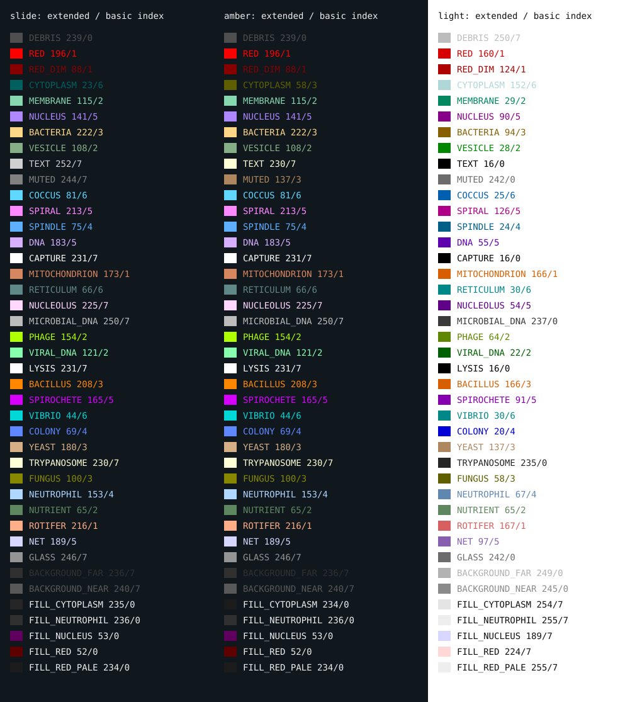

# Color identities

Colored themes use the same species identities. `amber` warms the cell interior
and interface while preserving entity colors. `light` uses darker counterparts
for a white background. The in-app `?` help is a scrollable legend, rendered in
its actual selected palette. Use arrows or j/k to reach all entries.

| Entity | Color family in the default dark theme | Additional identifying shape |
| --- | --- | --- |
| Macrophage | Mint | Large lobed membrane and violet nucleus |
| Neutrophil | Pale blue | Granules and lobed nucleus |
| Red blood cell | Red | Disc with dark center |
| Rod bacterium | Gold | Small rod and flagellum |
| Coccus | Sky blue | Round body |
| Short spiral | Pink | Short external flagellum and spiral body |
| Bacillary chain | Orange | Segmented chain |
| Spirochete | Vivid purple | Long traveling corkscrew wave |
| Vibrio | Turquoise | Comma and flagellum |
| Coccal colony | Royal blue | Beaded cluster |
| Yeast | Tan | Bud and vacuole |
| Trypanosome | Ivory | Tapered body and undulating membrane |
| Fungus | Olive | Branching filament |
| Phage | Lime | Tiny Runic fork or sideways fork |
| Nutrient cloud | Muted green | Sparse spreading dots |
| Rotifer | Coral | Segmented animal and two ciliary crowns |
| DNA trap | Pale lilac | Branching extracellular web |
| Micropipette | Neutral gray | Long tapered glass outline |

Bright lime is reserved for phage bodies; red entity outlines identify red blood
cells. Viral genomes use a related green, while food uses a subdued green.
Background particles use two neutral layers: smaller specks are fainter,
and larger particles have slightly more contrast. Their size-based depth cues
stay stable as they move; no extra particles are added. In colorless and basic
color modes, `.` versus `:` (or Unicode `·`) retains a shape cue. This is a visual
depth effect; all organisms still share the same two-dimensional simulation.
Capture and viral lysis highlights are white. Experimental rupture debris retains
the colors of its source cell and organelles.
Internal structures retain their own colors: violet nuclei, lilac chromosomes,
blue spindles, salmon mitochondrial tubules, teal ER, and muted-green vesicles.
Color families can be reused inside cells or for temporary effects because their
position and animation distinguish their meaning.

The audit sheet includes every `Ink` in enum order, its 256-color index, and its
basic-color fallback. Generate it with `python tools/colors.py`. Regression tests
check every palette's completeness, distinct external-entity indices, and a
minimum RGB separation between the nine microbial body colors. RGB separation is
a practical regression check, not a guarantee of perceptual or color-vision
accessibility on every display.

Eight-color terminals necessarily reuse colors across this many entities.
Monochrome, `--color never`, and differing color vision also make silhouettes,
relative size, motion, and the written legend essential. No species is identified
by color alone. `--ascii` preserves its structural distinctions when Unicode
characters are unavailable.
