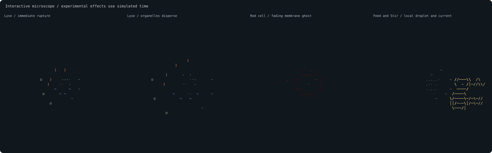

# Interactive microscope

Start with:

```sh
cells --interactive
cells --interactive --seed 42 --observe
```

Inspect is selected initially. A single bottom line shows `? help`, the selected
tool, and a brief identity or action message, truncated to the terminal width.
The rest of the screen remains available to the animation. Ordinary
ambient mode keeps its original controls and does not capture the mouse.

| Key | Tool | Apply with a left click or Enter |
| --- | --- | --- |
| `1` | Inspect | Select and follow a body |
| `2` | Lyse | Rupture the target immediately and scatter fragments |
| `3` | Feed | Place a nutrient droplet in clear fluid outside membranes |
| `4` | Stir | Apply a brief, local swirling current |

Use arrows or `h`/`j`/`k`/`l` to move the small corner reticle.
With `--magnification detail`, uppercase H/J/K/L pan the camera; lowercase
movement still aims the reticle. Clicking, selection, feeding, and currents map
back to specimen coordinates. The toolbar remains protected at every scale. `Tab` cycles visible
entities and follows the selection as it moves. `Enter` applies the active tool.
Panning or movement clears a tracked selection when its anchor leaves the view,
so Enter cannot lyse an invisible selection. Selection brackets mark the chosen
entity without recoloring it. The aiming
reticle leaves the glyph under it visible. Clicking the toolbar never acts on
objects underneath it. Help pauses the scene and ignores tool clicks.
Tool instructions appear in `?` help only when `--interactive` is enabled.

Mouse input depends on the terminal's mouse reporting support. All four tools
remain available with the keyboard. Only left-button presses/clicks apply
a tool; releases, movement, wheel scrolling, and other buttons do not. Release
events are received and discarded so curses keeps reading without blocking
animation after a click. Mouse
reporting and the previous click interval are restored when the session exits,
including through Ctrl-C or SIGTERM.

## Inspect

Click an entity's body or select one with Tab. Selection brackets follow it as
it moves. A disappeared selection clears automatically.

Picking follows the visible layer: captured prey can be selected in a membrane
cup, while a nucleus drawn in front of cargo remains part of the owning cell.
Tiny phages can be targeted directly on their one- or two-character bodies.

## Lyse

A click or Enter ruptures the target immediately. Fragments disperse and fade
over the following seven simulation seconds while the rest of the slide keeps
moving. There is no swelling delay or frozen target.

- **Macrophages and neutrophils:** scatter membrane, nuclear material, and colored
  organelle fragments. Claimed microbes are released cleanly; digested contents
  do not become live bacteria again. Rupturing a neutrophil already releasing a
  DNA trap ends that event cleanly.
- **Red blood cells:** leave a fading membrane ghost and red fragments, with no
  nuclear debris.
- **Microbes:** rupture into small membrane/DNA fragments and a nutrient patch.
  An infected bacterium releases only the progeny already represented by its
  assembly stage; early infection produces none.
- **Sealed phagosomes:** disrupting ingested cargo keeps the debris contained in
  the owner's digestive vesicle. It does not release free phages or extracellular
  nutrient patches through the surrounding cell membrane.
- **Fungal filaments:** sever the selected segment, preserving surviving branches
  and establishing regrowing cut ends after a short pause.
- **Free phages:** disrupt the particle into a few fading specks.

Rotifers are multicellular visitors and nutrient clouds are not cells; this tool
does not rupture those targets. Manual interventions can remove populations;
ordinary reproduction and replenishment still operate afterward.



## Feed and Stir

Feed uses the ordinary food-cloud behavior, so bacteria must move toward a patch
and reach it to feed. Deposits inside membranes are rejected. Food patches and transient feedback are capped to keep the slide
readable.

Stir immediately displaces nearby free particles, including the object directly
under the cursor, then sustains a swirling current for four simulation seconds.
The current reaches 24 world units (24 columns or 12 rows at normal magnification) from the click. It
moves free swimmers, red blood cells, debris, phages, spent capsids, and released
organelle fragments; large immune cells respond more gently. Existing membrane collision rules remain active. Stirring does not
teleport particles through a cell or detach sealed cargo.

## Pause, timing, and modes

Space pauses animation and simulation time. Inspect and aiming continue to work;
all tools apply immediately, including rupture, nutrient deposition, and Stir’s
initial particle displacement. Continued currents and fragment animation resume
when you unpause. Using a tool does not toggle pause. Speed controls also
scale experimental animations. Rare-event scheduling retains its independent
unpaused wall-time clock.

`--interactive` needs a terminal and cannot be combined with `--snapshot` or
`--screensaver`. `--diagnostics` can report that interactive mode was requested
without initializing the terminal. Mouse capability itself is checked only when
the interactive session starts. Seeds reproduce unattended simulations; user
actions additionally change the history.

Generate the illustrated states with `python tools/experiments.py`. Experimental
state is in `terminal_cells/lab.py`, tool input/HUD in `interaction.py`, and effect
drawing in `lab_render.py`. These are illustrative experiments, not quantitative
models of cell damage or fluid mechanics.
