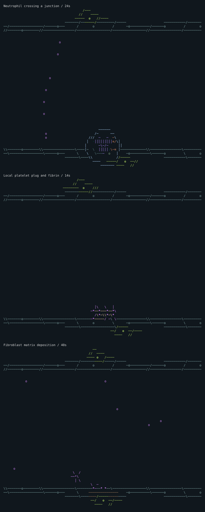

# Vessel and repair scene

Run `cells --scene vessel --observe` in a terminal at least 60 columns by 22
rows. More space, such as 120×40, makes the sequence easier to follow. The
ordinary mixed, blood, and microbial scenes retain their existing communities.

A slate lining of flattened endothelial cells borders the top and bottom of
the lumen. Yellow-green spindle-shaped fibroblasts crawl in the narrow tissue
bands outside it. Lavender platelets drift through the lumen as small discs.
Platelets are cell fragments and have no nuclei or reproductive cycle.

After about 35 simulation seconds, a small patch becomes injured. A suitable
nearby neutrophil can roll toward that patch, adhere, and squeeze through a
junction over 40 seconds. Its body and nucleus contract during crossing, and
it leaves through the adjacent screen edge. The ordinary arrival system later
brings in a replacement through an open vessel end. An engaged or dividing
immune cell is never taken away from its current interaction. Only one
neutrophil is recruited per injury.

Nearby platelets become spiky, approach the exposed site, spread on contact,
and form a local plug of at most eight fragments. Pale gold fibrin strands
connect attached platelets. The plug resolves as the patch closes, or after
110 seconds; released fragments fade out. Replacement platelets drift in from
the upstream screen edge.

After a delay, the tissue-side fibroblast crawls toward the injury and lays
down short, parallel brown matrix fibers. Several deposits gradually close the
gap. Fibers last at most 100 seconds, with no more than 16 retained at once.
The fibroblasts remain outside the lumen, distinct from branching fungal
networks. Even if a fibroblast is removed, a fallback closes the injury within
about 210 seconds. After a quiet interval, another patch can become injured.

`--no-events` disables spontaneous injuries; an existing repair still finishes.
In interactive mode, Inspect identifies the lining, fibroblasts, and platelets.
Lyse on an endothelial tile starts an injury. Platelets and fibroblasts can
also be lysed; replacements enter from an edge. Stir moves free platelets
immediately while attached platelets remain anchored. The lining constrains
suspended organisms even at a pictured injury: passive leakage into tissue is
not modeled. Junction crossing is an explicit neutrophil lifecycle.

Small windows suspend vessel details and return to the ordinary free-flow
presentation. Growing the window restores the lining and allows tissue cells
and platelets to enter again. Resizing during a neutrophil crossing cancels
that crossing and returns the cell to the resized lumen.



## Contributor entry points

`terminal_cells/vessel.py` owns the geometry, seeded event timing, platelets,
fibroblasts, and repair state. `World.vessel` is `None` outside this scene.
`geometry.obstacles()` shares the lining with collision and tool queries;
`geometry.targets()` exposes its living inhabitants for inspection.
`terminal_cells/vessel_render.py` draws the canonical glyphs without changing
state or consuming randomness. The stained style retains those marks; raster
converts them into its existing bounded pigment palette.

Repeatable fixtures exercise the real simulation:

```sh
python tools/gallery.py --scene vessel-rolling --style classic --output rolling.svg
python tools/gallery.py --scene platelet-plug --style classic --output plug.svg
python tools/gallery.py --scene wound-repair --style classic --output repair.svg
python -m unittest discover -s tests -p test_vessel.py -v
python tools/endurance.py --scene vessel --steps 27000 --fixed-size
```

See [the extension contract](EXTENSIONS.md) for camera, presentation, and
capability rules. Renderers can reinterpret this state without changing the
repair sequence. Useful future experiments include a stronger rolling cue,
more convincing junction deformation, and varied matrix textures.

## Biological scope

This is a compressed illustration, not a quantitative vessel, clotting cascade,
or wound-healing model. It combines inflammation, an injury plug, and tissue
repair in one convenient sequence. Real recruitment, hemostasis, and matrix
remodeling involve many additional cells and signals. Size, timing, recruitment
range, and clearance are chosen for terminal readability. No blood loss,
thrombosis, or disease is simulated.

Background for the ideas in the original issues:
[leukocyte interactions with inflamed vessels](https://pmc.ncbi.nlm.nih.gov/articles/PMC4280847/)
and [NIH overview of clot formation](https://www.nhlbi.nih.gov/health/clotting-disorders/how-blood-clots).
